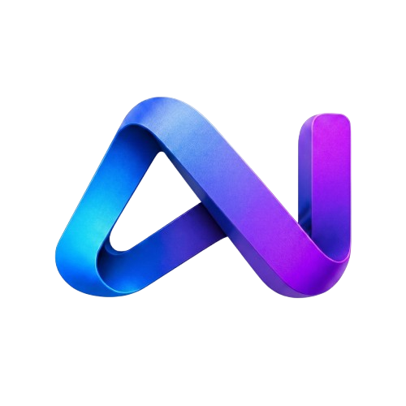

<p align="center">
  
</p>

<h1 align="center">AgentNexus Browse Helper</h1>

<p align="center">
  <strong>🤖 A powerful, extensible browser automation plugin that exposes browser capabilities to AI agents</strong>
</p>

<p align="center">
  <a href="./README_zh_CN.md">简体中文</a> | English
</p>

<p align="center">
  
  
  
  
</p>

---

## ✨ Overview

**AgentNexus Browse Helper** is a WXT / MV3-based Chrome extension that transforms your browser into a programmable automation platform for AI agents. It provides a rich set of tools following the OpenAI function-calling standard, enabling LLM-powered agents to interact with web pages, search content, capture resources, and perform complex automation workflows.

The plugin can be used in two ways:

1. **With the [AgentNexus](https://github.com/your-org/AgentNexus) main program** (recommended): scheduled by the main program over a WebSocket automation channel, ideal for complex multi-step workflows.
2. **Standalone**: configure your own model API (OpenAI / Claude / Gemini / Ollama, etc.) in the side panel chat mode, and chat with full tool access without the main program.

## 🔥 Core Features

### 🧰 Rich Tool System
**17 categories with 70+ built-in tools** at multiple abstraction levels: tab / window / navigation management, page clicking, filling and scrolling, screenshots (viewport, full page, element), network capture (CDP debugger), page source / content extraction, page cleaning (ad & tracker removal), resource sniffing and downloading, integrated search, history & bookmark management, text compression, XLSX read/write, Excalidraw canvas drawing, Bilibili subtitle fetching, code execution, and more.

### 🔌 Multi-Protocol Model Access
Native streaming adapters for **OpenAI, OpenAI Responses, Claude, Gemini, and Ollama**, unified into a single internal message stream; backed by SSE protocol contract tests (`tests/protocol-contract`) to keep protocol parsing accurate across vendors.

### 🧠 Context & Conversation Engine
A custom context engine (context metering, transcript engine, context-window guard) automatically trims and compresses history, while the chat database persists conversations — long sessions stay within limits and remain resumable.

### 🤖 Agent System
7 preset agents: Deep Search, Auto Action, Vision Assistant, Vision Action, Search Agent, Bilibili Agent, and Mindmap Assistant. Custom agents (model, prompt, toolset, skill mounting) can be created in the management hub.

### 📚 Skill System
Skill loading and resource reading tools, with 3 built-in skills: Bilibili video summary, web research report, and XLSX creator; skills support import/export and availability management (see "Skill Design" below for the design rationale).

### 🗂️ Management Hub
A dedicated management page for agents, skills, and configuration backup / restore.

### 📝 Built-in Notes
A Tiptap-based rich-text notes app; agents can create, read, update, append to, and delete notes directly via note tools.

### 👁️ Vision & Voice
Image attachments for vision models, local OCR via Tesseract.js, and OpenAI-compatible speech recognition (SiliconFlow / OpenAI / Groq / custom endpoints).

### 🖼️ Rich Message Rendering
Markdown rendering with Mermaid diagrams, KaTeX formulas, PlantUML, syntax highlighting, and one-click code copy.

### 📊 Usage Metrics
Token usage and request counts tracked per provider / model — real AI requests such as speech recognition are included.

### 🌐 Bilingual UI
Interface available in Simplified Chinese and English, switchable in one click and persisted globally.

### 🛡️ Safety Guards
Restricted-URL protection, a guard confirmation bar for dangerous actions, and declarative net request rules.

## 🧭 Skill Design

### Positioning
Agents running in the browser **have no Bash tool at this stage**, so skills cannot ship executable scripts. Skills in this project are therefore positioned as **reusable experience documents**: a structured `SKILL.md` that teaches the agent how to combine existing tools to handle a class of tasks. The format follows a browser-extension adaptation of the Agent Skills open spec (agentskills.io) — the spec's `scripts/` directory is never executed in this environment and is kept as plain-text reference only.

### What Belongs in a Skill
- **Workflow experience**: a complete methodology, e.g. the web research report flow of "decompose → multi-source search → cross-validate → log progress → summarize";
- **Scenario-specific solutions**: tool orchestration and parameter know-how for a specific task, such as the field conventions for creating an XLSX spreadsheet;
- **Site-specific guides**: an operating manual for a particular website, e.g. Bilibili video summarization — page-pattern recognition, prerequisites (logged-in state), when to call dedicated tools, and fallback strategies.

In short, a skill captures "the experience of how to get this done", not "code that runs for you".

### Skill Format
One skill = one `SKILL.md` (YAML frontmatter + Markdown body) + optional resource files (e.g. `references/*.md`). Key frontmatter fields:

| Field | Description |
|---|---|
| `name` | Skill name (lowercase letters / digits / hyphens). Duplicates are allowed — uniqueness is carried by the identifier below |
| `description` | What it does + when to use it — the model matches tasks against this, users enable by it |
| `allowed-tools` | Pre-authorized tool IDs (space-separated), callable directly once the skill is activated |
| `compatibility` | Environment requirements (optional), e.g. "requires a logged-in Bilibili session" |

### Progressive Disclosure (context-friendly)
1. **Discover**: the system prompt carries a persistent `<available-skills>` list — skill id + one-line description per entry;
2. **Activate**: skills pre-selected with `/` are injected automatically as one synthetic `load_skill` round when the message is sent; otherwise, when a task matches, the model calls `load_skill` itself to inject the full instruction (priority rules + SKILL.md body, soft cap: 15,000 characters);
3. **Dig deeper**: `read_skill_file` loads additional resource files by path (100,000-character cap per file).

### Getting Started
The three built-in skills (`skills/web-research-report`, `skills/bilibili-video-summary`, `skills/xlsx-creator`) serve as official templates — read and imitate them directly; enable/disable and import/export are available in the management hub.

## 📦 Implementation Stage

### ✅ Implemented
- Complete toolset (17 categories, 70+ tools) with 7 preset agents
- WebSocket communication and tool scheduling with the AgentNexus main program
- Official API access for OpenAI / OpenAI Responses / Claude / Gemini / Ollama (with contract tests)
- Standalone usage: agent engine, context engine, and conversation persistence
- Skill system (loading / import-export / availability management) and management hub
- Built-in notes, speech recognition, usage metrics, and bilingual UI

### 🔄 TODO
- Advanced features such as remote viewing
- More scenario-specific tools and skills

## 🚀 Quick Start

```bash
# Install dependencies
npm install

# Development mode (Chromium)
npm run dev

# Production build
npm run build

# Run tests
npm run test:contract   # SSE protocol contract tests
npm run test:engine     # Config engine tests

# Type checking
npm run compile
```

Build output lands in `.output/chromium-mv3`; load it via "Load unpacked" on `chrome://extensions` with Developer mode enabled.

## ⚙️ Configuration & Packaging

- **CHROME_EXTENSION_KEY (optional)**: create a `.env` file in the project root with `CHROME_EXTENSION_KEY=your-private-key`. Only needed when you want a fixed extension ID or to package with an existing private key; usually unnecessary during development. `wxt.config.ts` checks this value at build time and only writes it into the manifest `key` field when it is non-placeholder and looks valid.

- **version (required, used by the WS connection)**: set the `version` field in `package.json` to a semantic version (e.g. `1.0.0`). At build time `wxt.config.ts` reads it and injects it into the `version` query parameter of the WebSocket connection for backend logging and compatibility checks.

- **BROWSER_UUID (recommended, identifies the browser instance to the backend)**: if the backend needs a stable browser identifier, add `BROWSER_UUID=your-uuid` to `.env`. It is injected at build time into the client (as the `browserUuid` query parameter). To generate a UUID, use PowerShell `[guid]::NewGuid().ToString()` or visit https://www.uuidgenerator.net/.

Quick example:

1. Create `.env` in the project root:

```
CHROME_EXTENSION_KEY=YOUR_PRIVATE_KEY_HERE
BROWSER_UUID=37e07350-f2ca-46d1-9408-acd8c3d86294
```

2. Set `version` in `package.json`:

```json
"version": "1.0.0"
```

3. Run locally or package:

```bash
npm run dev
npm run build
```

After building, the WebSocket connection uses the following format:

```
ws://{host}:{port}/api/automation?browserUuid={browserUuid}&version={x.x.x}
```

## 🤝 Contributing

### ✅ Welcome
- Submit additional tool implementations following our guidelines

### ❌ Not Accepted Currently
- System architecture is under refactoring; other contributions are temporarily not accepted

## 📄 License

This project is licensed under the **GNU Affero General Public License v3.0** — see the [LICENSE](./LICENSE) file for details.

### 🏢 Commercial License

If you wish to use this project in proprietary software or commercial products that cannot comply with the AGPL-3.0 license terms, you can obtain a **commercial license**. Please contact us for licensing options and pricing.

## 🙏 Acknowledgments

- [mcp-chrome](https://github.com/hangwin/mcp-chrome) — portions of this project reuse its implementation (MIT License, by hangye). Special thanks to the original author for the open-source contribution.

## 📮 Contact & Links

- 🐛 [Issue Tracker](https://github.com/your-org/AgentNexus-Browse-Plugin/issues)
- 💬 [Discussions](https://github.com/your-org/AgentNexus-Browse-Plugin/discussions)

---

<p align="center">
  Made with ❤️ by the <strong>AgentNexus</strong> Team
</p>


### Vision Action GUI automation

Vision Assistant explains the current page and guides the user: bounded visible DOM reads, component scrolling in four directions, original-image crops, and readiness refreshes. The user performs clicks, typing, and submissions. Runtime checks prevent skills and extra tools from granting execution capabilities; arbitrary JavaScript is excluded. See [Vision Assistant design and boundaries](tools/vision/VISION_ASSISTANT.md).

Vision Action 使用 0–1000 的视口相对坐标和 CDP 输入，支持点击、拖拽、滚动、输入、悬停、键盘与按需 DOM 打标分析。厂商协议、工具参数、支持范围与迁移说明见 [视觉驱动说明](tools/vision/README.md)。
